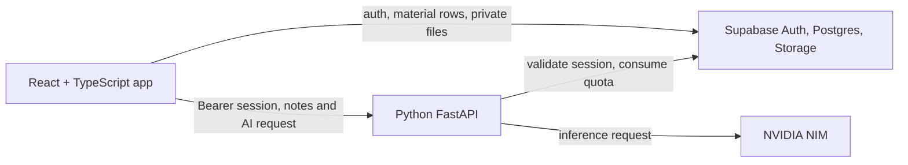

# Architecture

## System overview

The browser extracts text from uploaded documents. Supabase stores material text and (when an original file is uploaded) the private source file. AI requests go to FastAPI, which verifies the Supabase session, reserves quota, and calls NVIDIA NIM. The NVIDIA API key remains on the backend.

## Main areas

| Path | Responsibility |
| --- | --- |
| `src/App.tsx` | Hash router and application route tree. |
| `src/pages/` | Landing, authentication, dashboard, study, resources, energy check-in, feed, and game pages. |
| `src/components/` | Shared layout, page components, games, and UI primitives. |
| `src/lib/extractor.ts` | Browser-side PDF, DOCX, text, and image text extraction. |
| `src/lib/quizApi.ts` | Client-side study chunking and calls to `/api/quiz`. |
| `src/lib/materials.ts` | Material CRUD, local fallback, and private-file links. |
| `src/lib/supabase.ts` | Supabase browser client and configuration check. |
| `src/lib/checkins.ts`, `src/lib/gameProgress.ts` | Device-local check-in history and Workbench progress. |
| `src/stores/useAppStore.ts` | Shared in-memory application state. |
| `ai_service/main.py` | FastAPI routes, Supabase session/quota checks, and NVIDIA calls. |
| `ai_service/quiz_logic.py` | Input validation, question checks, local quiz/grade helpers, and summary chunking. |
| `ai_service/safety.py` | Local text safety classification. |
| `supabase/schema.sql` and `supabase/migrations/` | Database, RLS, storage, and incremental SQL changes. |
| `compose.yaml`, `Dockerfile`, `nginx.conf` | Local two-service deployment and frontend API proxy. |

## Request lifecycle

1. The app uses React Router hash routes. Authentication and cloud data use the Supabase browser client. The landing page does not create a guest session until a visitor chooses to start one.
2. When a user uploads a supported file, `extractor.ts` reads it in the browser and produces text. `materials.ts` saves text to Supabase (or local storage when Supabase is not configured) and uploads the original file to a private bucket when available.
3. `quizApi.ts` sends AI requests with the current Supabase access token. Question generation is split by the browser into small sections; grading sends the question's source quote; summaries submit the full notes for server chunking.
4. FastAPI validates the payload, checks the session with Supabase Auth, and uses the `consume_ai_usage` RPC before sending an inference request to NVIDIA.
5. Returned questions and summary citations are checked against source material before they are returned to the browser.

## State and persistence

- Cloud material records and uploaded originals are associated with the Supabase user and protected by row-level security and storage policies.
- If Supabase is not configured, material text can be saved in browser local storage. Cloud AI features still require configured Supabase credentials and a session.
- Check-in history and Workbench game progress are stored per browser in local storage. They do not sync across devices.
- Display preferences are also stored in browser local storage.

## Routes

Routes use hash routing so static hosting does not need server-side route rewrites:

| Route | Page |
| --- | --- |
| `/#/` | Landing page |
| `/#/start` | Guest, sign-in, and sign-up flow |
| `/#/home` | Dashboard |
| `/#/resources` | Saved materials |
| `/#/study` | Study sessions |
| `/#/energy` | Energy check-in |
| `/#/feed` | Community feed |
| `/#/game` | Check-in games and Workbench |
